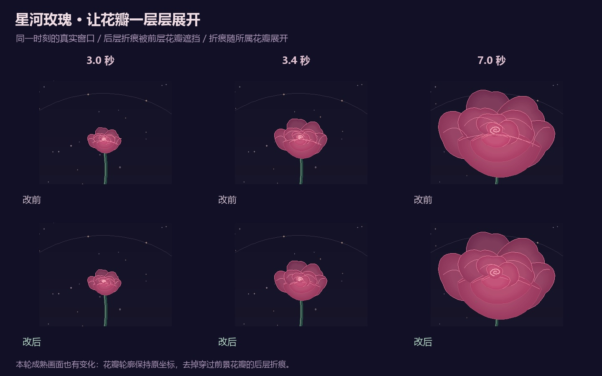
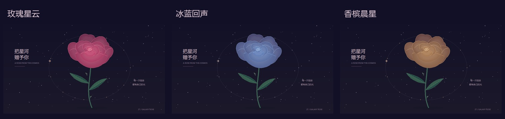

# 星河玫瑰：更清楚的花瓣层次

[30 天计划](NEXT_30_DAYS.md) · [本日记录](progress/2026-10-13.md) · [作品源码](../社团展示/27_星河玫瑰.py) · [返回画廊](../README.md)

**2026-10-13：折痕跟随各自花瓣展开，后层线条自然藏到前景花瓣后面。** 这是[茎尖衔接修复](ROSE_GROWTH.md)之后的一次细节完善，保留原来的花瓣轮廓与三种配色。



## 画面有什么变化

原程序先画完全部花瓣，再统一画八条折痕。这样的顺序让后排折痕浮到最前面，穿过花心和前景花瓣；生长时，折痕使用整体展开进度，花瓣使用各自的展开进度，线条还会偏离所属花瓣。

现在每片花瓣画完明暗和边缘后，立即画属于它的折痕。后续花瓣自然遮住后排线条，折痕也使用同一片花瓣的展开幅度。花瓣的外形坐标、配色和生长时长保持原设置；**成熟画面的折痕也会变化**。



## 体验方法

```bash
python run.py --demo 27
```

按 **G** 重播，观察约 3 秒的花苞与完全展开后的花心。按 **C** 切换三种配色，**↑ / ↓** 调整速度，**空格**暂停，点击绘图区洒下星尘。G 保留当前主题、速度和背景时间；R 恢复初始状态。

## 验证与预览

- 以 `846a55b` 为改前版本，三主题 × 两种窗口（1000×720、760×580）× 六阶段，共 **36 对真实窗口截图**。变化均位于花冠区域。
- 每版 **84 项直接回调检查**通过，覆盖暂停、重播、调速与重置；每种窗口四轮生长的 Canvas 峰值均为 **377**，预热后数量稳定。
- 两项新增测试在旧代码上出现 **86 个失败子条件**，修复后通过：后层折痕被前景花瓣遮挡；生长时折痕与所属花瓣位置一致。原有三项生长衔接测试也通过。
- 独立审查后补查折痕高于自身全部填色层。内存中故意把折痕移到明暗层下方，16 处检查如期失败；实际实现通过。最终完整回归 **306 项：305 通过、1 项可选桌面字体检查跳过**，测试进程退出码为 0。
- 更新四张玫瑰预览、首页封面、浪漫光影组合图与动图。两张组合图的玫瑰区域之外逐像素一致；动图其余 **72 帧**解码后逐像素一致。玫瑰片段重录 24 帧，其中前 12 帧像素相同，后 12 帧体现变化。
- 动图仍为 720×460、96 帧，每帧 150 ms。[源码哈希、截图条件和素材记录](benchmarks/rose-folds.json)可用于核对这次结果。

这些是固定时间截图、真实绘制输出和直接回调检查；真人键鼠手感、手机观看、实时帧率和新的十分钟巡展不在此次验收范围内。上一轮生长报告保留当时版本，不能把其中“成熟画面不变”的结论套到这次折痕修改上。

## 接下来

按既有分镜制作的[20 秒无声试片](SOCIAL_ROSE.md)已在后续迭代完成，展示重播生长、三色切换与一次星尘互动。接下来补实际操作和手机观看反馈，再制作正式声音与封面；蝶舞有声候选片仍待手机观看与试听。每天的人工安排继续控制在 60 分钟内。
