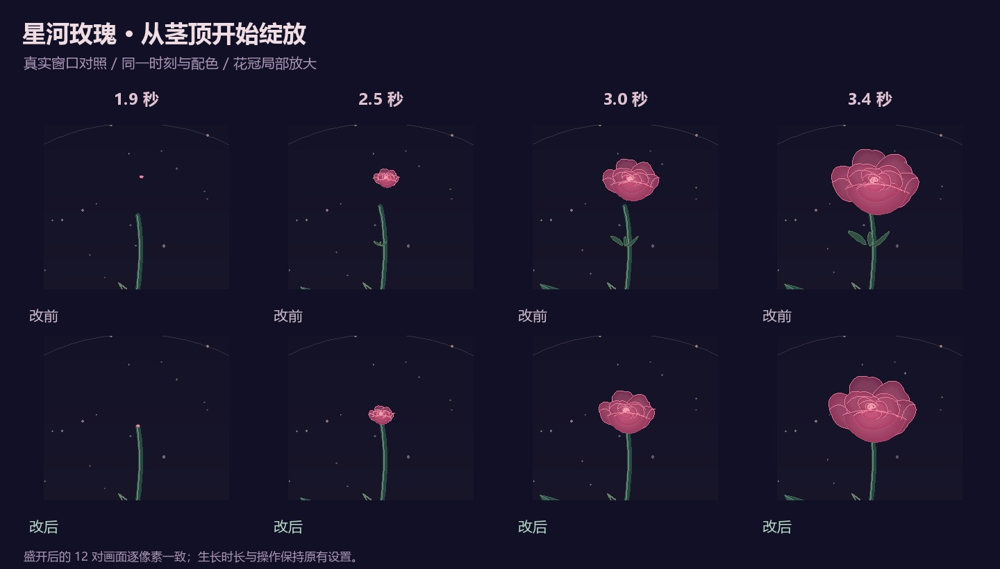
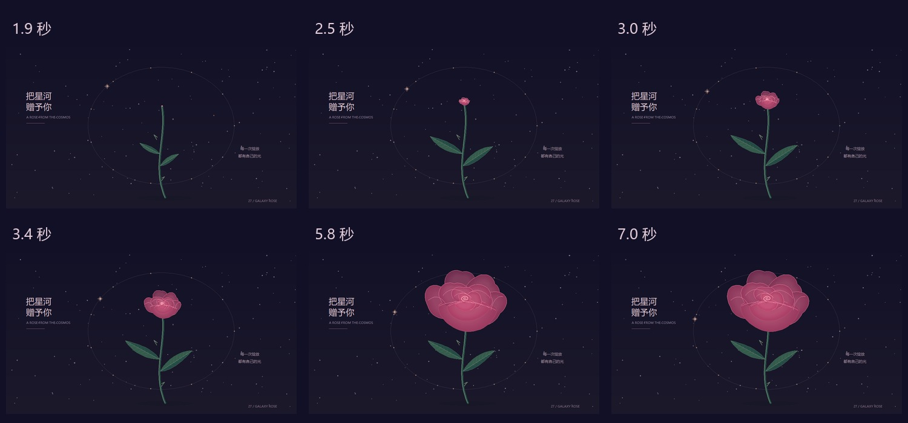

# 星河玫瑰：从茎顶开始绽放

[30 天计划](NEXT_30_DAYS.md) · [执行记录](progress/2026-10-13.md) · [作品源码](../社团展示/27_星河玫瑰.py) · [返回画廊](../README.md)

> 本文记录生长衔接修复的历史对照，交付版本为 `846a55b`。10 月 13 日后续完成了[花瓣折痕层次改进](ROSE_FOLDS.md)；该次更新会改变成熟画面，下面的截图与验证结论仍对应此前版本。

**2026-10-13 整理交付：生长衔接修复与画面对照已于 10 月 12 日完成。** 按 G 重播时，花苞与萼片从正在生长的茎顶展开，消除了早期悬空的间隙。



## 这次改了什么

检查原程序的 1.9、2.5、3.0 秒画面时，可以看见花苞浮在茎尖上方。原来花冠缩向约 `y=120`，茎的终点是 `y=77`，萼片则缩向 `y=20`，三者没有共同的生长起点。

现在每个生长阶段都取当前可见茎尖作为展开起点，花瓣和萼片随展开程度插值到原有成熟坐标。完全展开后偏移归零。**5.8、7.0 秒，三主题 × 两种窗口的 12 对成熟画面逐像素一致。**



## 如何体验

```bash
python run.py --demo 27
```

| 操作 | 效果 |
| --- | --- |
| G | 保留当前配色，重播生长 |
| C | 玫瑰星云 / 冰蓝回声 / 香槟晨星 |
| ↑ / ↓ | 调整速度，范围 0.25–2.5 倍 |
| 点击绘图区 | 洒下星尘 |
| 空格 / R / Esc | 暂停或继续 / 重置 / 关闭 |

观察前 3 秒茎尖与花苞的连接，再看花瓣完整展开。这里的“秒”是默认速度下的生长进度；调速或 G 重播后，生长进度与背景动画时间可以不同。

## 验证与素材更新

- 以 `bee05a9` 为改前版本，只替换玫瑰源码，舞台、截图工具和环境一致。1000×720 / 760×580，三主题、六阶段，共 **36 对真实窗口截图**。
- 成熟态 12 对相同，其余 24 对体现生长位置调整。截图通过自建窗口的 `capture_artwork` 获取，原图留在本地 `.work/rose-growth`。
- 每版完成 **84 项直接回调检查**，覆盖两种速度、暂停、G 保留主题重播、R 恢复初始画面。每种窗口四轮生长，Canvas 峰值均为 **377**，预热后逐阶段数量稳定。
- 新增 3 项回归测试：花瓣覆盖茎尖、萼片从茎尖出现、成熟花瓣坐标保持原值。旧代码出现 31 个失败子条件，修复后通过。
- 完整回归 **304 项：303 通过、1 项可选桌面字体检查跳过**。独立审查另外检查了重播后时间与生长进度不同步的组合，未发现连接缺口。
- 使用已有录制入口重新生成 27 的 24 帧动图素材。四张成熟静态预览与仓库原文件字节相同；[画廊动图](assets/romantic.gif)仅替换玫瑰的 24 帧，其余 **72 帧解码后逐像素一致**。动图仍为 720×460、96 帧，每帧 150 ms。

[完整条件、源码哈希、截图比较与动图记录](benchmarks/rose-growth.json)

这些是固定时间截图和直接回调检查，不代表真人键鼠体验、手机验收、实时 FPS 或重新完成十分钟巡展。10 月 11 日巡展报告保留当时的源码版本，没有改写成此次结果。

## 下一步只推进一件事

先在桌面实际按 G、调速和暂停观察生长手感，记录一个最明显的问题。这里提出的后层花瓣折痕候选已在 10 月 13 日后续迭代中完成，见[独立对照记录](ROSE_FOLDS.md)。

第三周录制可沿用这个短分镜：**茎与花苞出现 → 花瓣展开 → 完整玫瑰 → 一次点击星尘**。镜头需要保留花茎和完整花冠；当前尚未录制玫瑰主视频。蝶舞的有声候选片仍等手机观看与试听，继续保留一条视频草稿。
