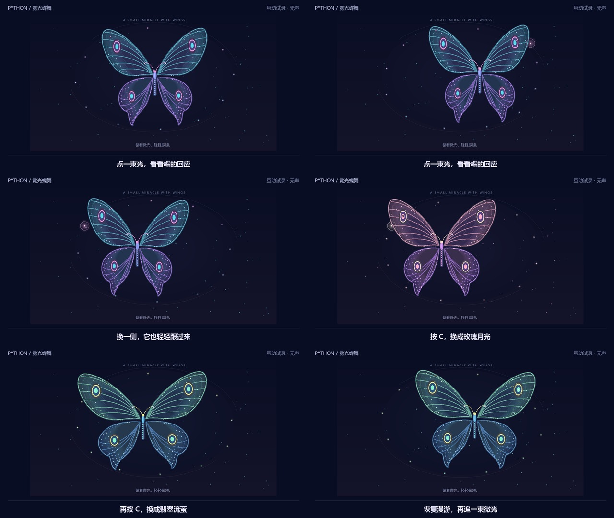
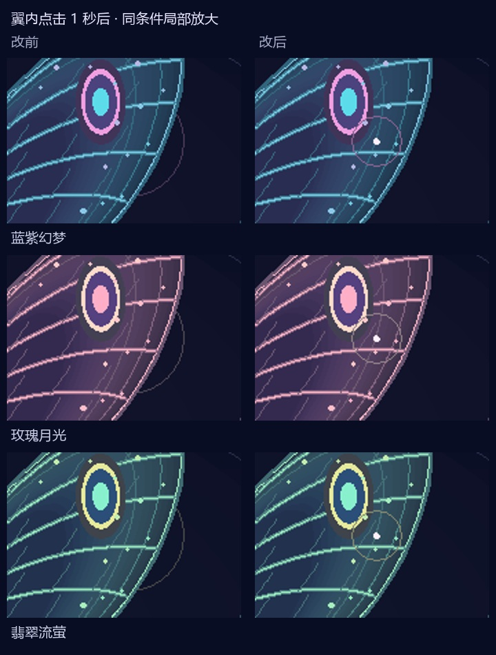

# 霓光蝶舞：20 秒互动分镜与试录

[30 天计划](NEXT_30_DAYS.md) · [执行记录](progress/2026-10-11.md) · [返回画廊](../README.md)

**2026-10-12 状态：翼内点击提示已修复，真实程序试片已重新录制，尚未投稿。** 10 月 11 日完成了 D6 分镜与 D8 录制流程；本轮提前完成 D9 的单项画面改进。正式视频仍需要手动体验、手机观看和声音检查。

[观看 / 下载 20 秒试片](assets/social-butterfly/preview.mp4) · [字幕](assets/social-butterfly/captions.zh.srt) · [素材与源码记录](assets/social-butterfly/manifest.json)



## 镜头顺序

目标是让观众看懂“代码画出的蝶会回应操作”，结尾引导关注个人账号。使用 B 站横屏画幅，保留完整蝶翼；当前试片为 1280×720、30 fps、600 帧、20 秒，无音轨。画面是 Windows 上真实 Tk 窗口的绘图区，字幕后期添加。

| 时间 | 程序操作 | 观众看到什么 |
| --- | --- | --- |
| 0–4 秒 | 0.8 秒点击右上方 `(280,150)` | 完整蝶翼出现，光源亮起，蝶身小幅右移；字幕“点一束光，看看蝶的回应” |
| 4–8 秒 | 4 秒点击左侧 `(-280,110)` | 光源换边，蝶身缓缓向左移动 |
| 8–10 秒 | 8 秒按 C | 蓝紫幻梦切换为玫瑰月光 |
| 10–12 秒 | 10.5 秒按 M | 固定蝶身位置，蝶翼继续振动 |
| 12–14 秒 | 12 秒按 C | 固定位置下切换为翡翠流萤，方便观察配色 |
| 14–18 秒 | 14 秒按 M；14.2 秒点击 `(230,145)` | 恢复漫游，再展示追光；光源落在蝶翼内部时，小光点和细环仍然可见 |
| 18–20 秒 | 保持画面 | “关注我，继续看代码画出的小世界” |

坐标是作品的逻辑坐标。录制器调用与点击 / C / M 相同的场景回调，**没有模拟系统鼠标键盘，也不截取鼠标指针**。固定步长录制保证事件时刻可复现，30 fps 是成片帧率，不是作品的实时性能测试结果。M 只固定位置；蝶身向光源方向小幅移动，不会飞抵点击点。

## 已完成：翼内点击也有清楚的回应

10 月 11 日试录第 15 秒的真实画面中，第三次点击的光源处于右上蝶翼内部，明亮提示被蝶翼覆盖。原因是光源整体在蝶翼之前绘制。外侧点击的光圈则可以看见；这是自行体验发现的问题，没有归因为观众反馈。

现在保留背景柔光，把 2 像素光点和空心细环放到蝶翼、身体与萤火前面，场景文字仍在最上层。细环在 0.9 秒内从半径 8 扩散至 18 个逻辑像素，最后 0.7 秒随光点一起变暗，6 秒目标到期后移除。提示不增加新的持久状态，蝶翼形状、翅脉与眼斑保持原有绘制。



三主题、两种窗口、翼内 / 翼外点击后 0.2 秒和 1 秒，共保存 **24 对真实画面对照**；未点击的 6 对画面逐像素一致。暂停与重置的实际画面检查通过，重复点击 / 过期的对象复用测试通过。当前试片已按原分镜重新录制 600 帧，10 月 11 日原帧留在本地作为历史对照。

| 窗口 | 总绘制耗时中位数：改前 → 改后 | P95：改前 → 改后 | Canvas 对象数 |
| --- | --- | --- | --- |
| 1000×720 | 24.525 → 24.491 ms | 27.002 → 26.489 ms | 532 → 532，采样期间稳定 |
| 760×580 | 22.986 → 22.953 ms | 25.357 → 24.831 ms | 532 → 532，采样期间稳定 |

这是同机顺序运行的一组回归对照：每个版本、每种窗口预热 20 帧后采样 120 帧，采样期间点击提示仍有效；耗时包含手动 `frame` 与 Tk 更新，不包含截图。数值接近，**不据此宣称性能提升或实时帧率**。完整条件、截图清单与源码哈希见[报告](benchmarks/butterfly-feedback.json)。可复现：

```powershell
python tools/check_immersive.py --works 28 --baseline-ref bd84d17 --samples 120 --output .work/butterfly-feedback-recheck
```

## 可以直接使用的投稿文案草稿

**标题：** 我用 Python 画了一只会追光的蝴蝶

**简介：**

> 点亮一束微光，让它轻轻靠近。
>
> 蝶翼、翅脉和鳞片都由 Python 绘制，支持点击追光、C 换色、M 固定位置。
>
> 蓝紫幻梦、玫瑰月光、翡翠流萤，你喜欢哪一种？
>
> 关注「难安这余念」，继续看代码画出的小世界。
>
> 项目：https://github.com/zjh-b/turtle-gallery
>
> 画面来自真实程序，制作使用了 AI 辅助开发；互动作品需要在电脑运行。

**标签草稿：** Python、编程、创意编程、蝴蝶、代码绘画。

正式投稿前移除画面上的“互动试录 · 无声”标识，并使用最终验收素材。若增加声音，只选有使用权的素材或自行合成；没有可用声音也可以保留有意设计的无声版本。这里未上传 B 站，也未修改现有「三个互动世界」稿件。

## 本地复现

Windows 桌面保持解锁，窗口展开。录制只截取自己创建的作品窗口；关闭该窗口或按 Esc 可以中止，不会产生成功的 `capture.json`。失败目录里的部分帧可用于排查，重试请选择新目录。

```powershell
python -m pip install -r requirements-export.txt
python tools/capture_butterfly_video.py --output exports/butterfly-frames
python tools/render_butterfly_preview.py --capture exports/butterfly-frames --output exports/butterfly-preview
```

第二条命令输出原始 PNG 帧和 `capture.json`，第三条需要 PATH 中提供带 libx264 的 FFmpeg，也可加 `--ffmpeg <可执行文件路径>`。合成器输出 `preview.mp4`、`storyboard.jpg`、`captions.zh.srt` 和 `manifest.json`。两个输出目录都必须是新目录。

仅检查窗口录制是否可用，可以先用 `--seconds 2 --output exports/butterfly-probe`；完整合成只接受 20 秒素材。录制支持 `--fps 24` 或 `--fps 30`，事件会量化到最近一帧。已有 29/30/31 影片的录制和合成入口继续使用原来的工具。

录制前后核对源码版本，合成前拒绝缺帧、过期源码或不同事件顺序；合成记录还保存每个输入帧和输出文件的 SHA-256。原始 600 帧保存在本地忽略目录，仓库只收录可浏览的试片、六格图、字幕和记录。

## 本轮检查

本机完成 600 帧真实窗口录制，查看六格分镜和点击后的原始画面。FFprobe 确认 H.264、1280×720、30 fps、600 帧、20.000 秒且无音轨；FFmpeg 完整解码通过。事件状态记录确认三种主题、位置固定与恢复均按分镜发生。

录制相关 7 项测试覆盖事件量化、缩放坐标、三主题与悬停语义、错误参数、过期素材，以及交付文件和源码的一致性。本轮再增加 2 项针对点击提示的回归测试，覆盖绘制层次、暂停、淡出、过期、重置及重复操作。完整回归共 291 项，290 项通过，1 项可选桌面字体检查跳过。字幕使用 LF 换行，确保 Windows / Linux 签入签出后字节校验仍一致。手机观看和实际键鼠完整体验尚待完成。

## 下一次的 1 小时

| 工作 | 人工预算 |
| --- | --- |
| 实际鼠标点击、C / M、空格与 R 操作一遍 | 15 分钟 |
| 手机上完整看试片，记录设备与字幕可读性 | 20 分钟 |
| 确定正式封面和声音处理，补可用的后台指标 | 15 分钟 |
| 保存实际反馈与用时，确定是否进入成片制作 | 10 分钟 |

实际人工用时由执行者记录，不把 AI 操作或渲染等待代填为已用时间。手机实机检查、后台缺失指标和发布约 72 小时的数据快照仍按原计划补齐；本轮没有将它们标为完成。
