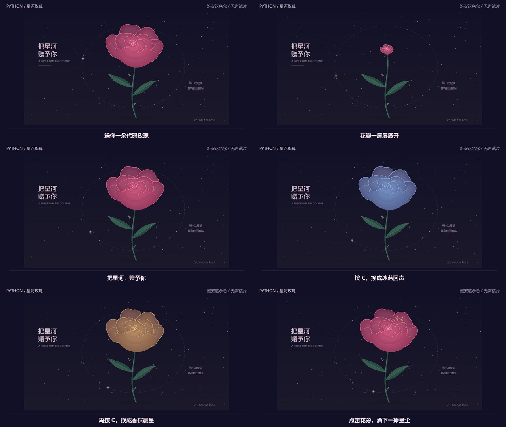

# 星河玫瑰：20 秒生长与星尘

[30 天计划](NEXT_30_DAYS.md) · [花瓣层次改进](ROSE_FOLDS.md) · [发布后记录](progress/2026-10-14.md) · [返回画廊](../README.md)

**已于 2026-10-14 17:34:40（北京时间）发布至 B 站：[用 Python 种一朵玫瑰，点击还会洒星尘](https://www.bilibili.com/video/BV1Jnp26RERi/)。** 账号「难安这余念」（UID 3546966168438889），稿件 BV1Jnp26RERi；稿件管理显示已发布，公开 API 已核对标题、作者与可用状态。

正式片已去掉试片标签，完成两版封面，并使用必剪官方音乐库的 **《小美满》— 周深** 配乐。本地正式片为 20.000 秒、1280×720、30 fps、600 帧；B 站显示时长 21 秒。实际手机观看、试听及真人键鼠体验仍待补，不因发布完成而代填验收。

仓库保留可复现的**无声试片**、分镜与字幕；配乐成片在 B 站观看，音乐文件和配乐 MP4 不作为仓库下载素材。下方录制命令生成无声试片，不会生成平台配乐版本。

**[在 B 站观看已发布成片](https://www.bilibili.com/video/BV1Jnp26RERi/)** · [下载 20 秒无声试片](assets/social-rose/preview.mp4) · [字幕](assets/social-rose/captions.zh.srt) · [素材和源码记录](assets/social-rose/manifest.json)

[横版封面（16:9）](assets/social-rose/cover.png) · [推荐流封面（4:3）](assets/social-rose/cover-4x3.png) · [公开发布记录与封面校验](assets/social-rose/publication.json)



## 这条视频讲什么

开场先让观众看到一朵完整玫瑰，再演示它如何从花茎长出来。花瓣展开后，用三种配色和一次星尘点击展示互动，结尾引导关注个人账号「难安这余念」。

| 视频时间 | 程序动作 | 画面与字幕 |
| --- | --- | --- |
| 0–1.2 秒 | 保留预热后的成花 | “送你一朵代码玫瑰”，完整花冠与花茎入画 |
| 1.2–3.2 秒 | 1.2 秒调用 G 重播 | 花茎重新出现，“按 G，从一根花茎开始” |
| 3.2–6.5 秒 | 按原速度继续生长 | “花瓣一层层展开”，可以观察花苞连接和前后层次 |
| 6.5–8.5 秒 | 保留成花 | “把星河，赠予你” |
| 8.5–11 秒 | 8.5 秒调用 C | 切到冰蓝回声 |
| 11–13.5 秒 | 11 秒调用 C | 切到香槟晨星 |
| 13.5–18 秒 | 13.5 秒回到玫瑰星云；14 秒点击 `(90,145)` | 24 粒星尘从花旁散开，随后自然消失 |
| 18–20 秒 | 保留完整画面 | “关注我，继续看代码画出的小世界” |

录制前用固定步长预热 7 秒，第一帧是成熟玫瑰。仓库无声试片共 600 帧，1280×720、30 fps、20 秒、H.264，**没有音轨**。原始窗口绘图区为 1333×737，合成时等比缩放，字幕放在画面下方；没有裁掉花茎或补画图像。

动作由与 G / C / 点击相同的场景回调执行，没有模拟系统键鼠或录下鼠标指针。30 fps 是成片帧率，不代表程序实时性能；真实设备上的操作手感仍需要单独体验。

## 可以重复使用的录制入口

Windows 桌面保持解锁，Pillow 需要 11.2.1 或更新版本；合成另需 PATH 中提供包含 libx264 的 FFmpeg。作品本身继续只用 Python 标准库。

```powershell
python -m pip install -r requirements-export.txt
python tools/capture_rose_video.py --output exports/rose-frames
python tools/render_rose_preview.py --capture exports/rose-frames --output exports/rose-preview
```

输出目录必须是新目录。第一步录制生成 PNG 帧和 `capture.json`；合成输出 `preview.mp4`、`storyboard.jpg`、`captions.zh.srt`、`manifest.json`。也可以用 `--fps 24` 录制，或用 `--seconds 2` 做窗口探测；完整合成只接受 20 秒素材。FFmpeg 不在 PATH 时，给合成命令加 `--ffmpeg <可执行文件路径>`。

只截取自己创建的作品窗口。录制期间关闭窗口或按 Esc 可以中止；其它操作键被暂时禁用，避免改变固定分镜。中止、画幅变化或源码变化时，不会写出成功的录制清单，已录部分帧留在失败目录供排查，重试需新目录。

合成会拒绝缺帧、错误分镜、过期源码和尺寸变化。同一帧的哈希、视频画面与分镜缩略图来自同一次 PNG 读取；编码失败会清理本次生成的文件，已有目录不会被覆盖。源码与交付文件 SHA-256 均记录在清单中。原始帧放在本地忽略目录，仓库保留可观看的交付素材。

## 无声试片检查（2026-10-13）

- 600 帧实际窗口录制完成，事件前后状态记录确认 G 重播、三色循环和一次 24 粒星尘点击；末帧星尘已过期。
- 查看六格分镜与实际 H.264 解码帧，完整花冠、花茎和字幕可见。
- FFprobe 确认画幅、帧数、帧率、时长与无音轨状态，FFmpeg 完整解码通过，见[媒体检查报告](benchmarks/rose-preview.json)。
- 测试覆盖成熟开场、回调坐标、事件时间、窗口关闭、源码变化、目录保护、编码失败清理、单次帧读取与交付素材一致性；独立代码审查未发现重要问题。
- 完整回归 **330 项：329 通过、1 项可选桌面字体检查跳过**，进程退出码为 0。录制器 14 项测试及合成/交付 10 项测试包含在其中。

这些是无声试片的历史检查结果，不代表已完成手机观看或真人操作。10 月 14 日的正式片、封面与发布记录见[本日记录](progress/2026-10-14.md)。

## 发布后下一步（最多 1 小时）

按实际发布时间，玫瑰约 24 小时和 72 小时的数据采集候选时间为 **10 月 15 日 17:35、10 月 17 日 17:35（北京时间）**。这是手动查看的建议时间，没有设置定时任务；错过就记实际采集时间，不倒填。首条「三个互动世界」约 7 天快照仍可在 10 月 17 日中午附近补录。

| 工作 | 人工预算 |
| --- | --- |
| 到采集时间时记录玫瑰实际数据、采集时间与真实评论 | 10 分钟 |
| 手机完整观看已发布玫瑰，检查开场、字幕、星尘与配乐音量 | 15 分钟 |
| 手机完整观看并试听[蝶舞候选片](SOCIAL_BUTTERFLY.md)，记录设备和问题 | 20 分钟 |
| 保存实际用时与反馈，最多选一项有依据的改进；无问题则留作缓冲 | 15 分钟 |

未取得的播放、完播、平均观看时长或单稿关注数据保持缺失，不写成零；账号粉丝变化不直接归因于这条视频。玫瑰真人键鼠体验继续列为待办，按剩余预算顺延。实际人工用时由执行者记录。
